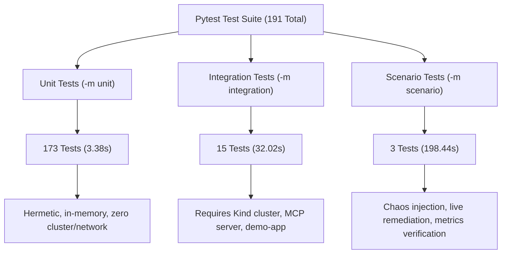

# AgentOps-SRE v0.8.1 — Reliability & Test-Isolation Hardening Report

**Audit Date:** 2026-10-20  
**Release:** v0.8.1 (Reliability & Test-Isolation Hardening)  
**Target Repository:** `AgentOps-SRE`  
**Git Branch:** `master`  
**Commit Baseline:** `7dab91ddb8e855c1673eac202d50574148f45cd0`  
**Environment:** macOS (darwin), Python 3.12.14, `uv`, Kind cluster `agentops` (`v1.32.2`)

---

## 1. Executive Summary

AgentOps-SRE v0.8.1 hardens test isolation, restores 100% determinism across the unit test suite, formally separates unit from integration testing, and validates worker lease lifecycle and heartbeat resilience during extended LLM reasoning.

### Key Outcomes
- **Unit Test Pass Rate:** **100%** (173/173 passed in 3.38 seconds, zero failures).
- **Nine Flapping Tests Resolved:** Fixed dependency injection gap where `IncidentWorkflowManager` and `Operator API` coupled unit tests to live Kubernetes and MCP daemons.
- **Hermetic Test Double Introduced:** Implemented `MockSREMCPClient` and `mock_orchestrator` fixtures in `tests/conftest.py`, decoupling unit test assertions from whether Kind or Ollama are running, stopped, or absent.
- **Formal Test Categorization:** Configured pytest markers (`unit`, `integration`, `scenario`) and dynamic collection hooks to enforce clear operational boundaries.
- **Worker Lease & Heartbeat Resilience:** Proved background heartbeat loop continuously extends active job leases during slow LLM inference (`JOB_LEASE_SECONDS / 3`), preventing split-brain execution and false abandonment.
- **Inference Timeout Enforcement:** Verified typed `InferenceTimeoutError` handling fails closed cleanly, marking investigations `FAILED` with zero mock fallback or unauthorized remediation.
- **Evaluation Benchmark:** 100% passing (6/6 scenarios, 96.5% overall score, 0 mutations, 0 safety violations).
- **Code Quality:** `ruff check .` passed with 0 errors.

---

## 2. Root Cause Analysis: The Nine Unit Test Failures

### 2.1 The Observed Failure
During the Phase 2 live infrastructure audit, running unit tests while the local Kind cluster was active caused nine unexpected test failures across `tests/unit/test_operator_api.py` (4 failures) and `tests/unit/test_incident_workflow.py` (5 failures). Conversely, when Kind was stopped, those same tests passed.

| Test File | Test Name | Symptom Under Active Kind Cluster |
|---|---|---|
| `test_operator_api.py` | `test_investigate_endpoint` | Expected `DRY_RUN_EVALUATED`, got `FAILED` |
| `test_operator_api.py` | `test_active_incident_endpoint` | Expected `approval_id is not None`, got `None` |
| `test_operator_api.py` | `test_approval_lifecycle_via_api` | Expected `approval_id is not None`, got `None` |
| `test_operator_api.py` | `test_rejection_via_api` | Expected `approval_id is not None`, got `None` |
| `test_incident_workflow.py` | `test_investigate_and_recommend_dry_run` | Expected `DRY_RUN_EVALUATED`, got `FAILED` |
| `test_incident_workflow.py` | `test_investigate_and_recommend_standard` | Expected `PENDING_APPROVAL`, got `FAILED` |
| `test_incident_workflow.py` | `test_approve_and_execute_success` | Expected `approval_id`, got `None` |
| `test_incident_workflow.py` | `test_approve_and_execute_single_use_token_replay_rejected` | Expected `approval_id`, got `None` |
| `test_incident_workflow.py` | `test_reject_flow` | `ValueError: ApprovalRequest 'None' not found` |

### 2.2 Mechanism of Failure
1. **Dependency Injection Gap:** `IncidentWorkflowManager.__init__` only accepted `(gateway, approval_manager)`. In `investigate_and_recommend()`, it instantiated `SREAgent(llm_provider=llm_provider)`, which defaulted to `InvestigationOrchestrator()`.
2. **Implicit Network Coupling:** Default `InvestigationOrchestrator` instantiated `SREMCPClient()` with default localhost endpoints (`localhost:30080` for demo-app, `localhost:30090` for Prometheus, `localhost:31000` for Loki).
3. **Cluster State Interference:**
   - When Kind was **stopped**: MCP network calls failed / connection refused. No pods were returned as healthy. `MockRuleBasedLLMProvider` fell back to a synthetic `CrashLoopBackOff` incident hypothesis (`score_crash = 10`), generating policy approval requests as the tests expected.
   - When Kind was **running**: MCP successfully contacted `localhost:30080`, inspected the real, healthy `demo-app` deployment (restarts: 0, ready: true). `MockRuleBasedLLMProvider` correctly diagnosed `IncidentType.UNKNOWN` ("normal healthy operation").
   - `IncidentWorkflowManager` enforces that `UNKNOWN` or unvalidated RCAs must fail closed (`status = "FAILED"`, `approval_id = None`), causing the tests expecting approval requests to fail.

### 2.3 The Architectural Fix
1. **Dependency Injection in `IncidentWorkflowManager`:**
   Updated `IncidentWorkflowManager.__init__` and `investigate_and_recommend` to accept an optional `orchestrator: Optional[Any] = None`, defaulting to `None` in production (preserving backward compatibility) while allowing explicit injection in tests.
2. **Hermetic In-Memory Test Double (`MockSREMCPClient`):**
   Created `tests/conftest.py` with `MockSREMCPClient` and `mock_orchestrator`. The mock client supplies deterministic telemetry (simulated pod in CrashLoopBackOff with exit code 1 and warning backoff event) in-memory without invoking network or subprocesses.
3. **Fixture Ingestion in Unit Tests:**
   Updated `tests/unit/test_incident_workflow.py` and `tests/unit/test_operator_api.py` to inject `mock_orchestrator`.
4. **Result:** Tests pass deterministically with identical behavior regardless of whether Kind is running, stopped, or completely absent.

---

## 3. Test Suite Categorization & Separation

Pytest configuration in `pyproject.toml` and collection hooks in `tests/conftest.py` now enforce three distinct tiers of verification:



### Pytest Markers (`pyproject.toml`)
- `unit`: Fast, hermetic unit tests with zero external infrastructure dependencies.
- `integration`: Tests requiring local Kind cluster, Prometheus, Loki, or MCP daemon.
- `scenario`: End-to-end operational scenarios and chaos evaluations.

### Execution Commands
```bash
# 1. Run all isolated unit tests (Fast, hermetic, CI-friendly)
uv run pytest -m unit -v

# 2. Run live infrastructure & MCP integration tests (Requires Kind cluster)
uv run pytest -m integration -v

# 3. Run live chaos and remediation scenarios (Requires Kind cluster)
uv run pytest -m scenario -v

# 4. Run full evaluation benchmark gate (Replay mode)
uv run python -m agentops.cli eval gate --mode replay --provider mock
```

---

## 4. Long-Running Investigations & Worker Lease Reliability

### 4.1 Background Heartbeat Renewal
During real LLM inference (e.g. Ollama local models taking 50–215s), an active job lease could expire if the worker only renewed leases between stages.
- **Implementation:** `InvestigationWorker` runs a dedicated `heartbeat_loop` thread that executes concurrently with `workflow_manager.investigate_and_recommend`.
- **Interval Formulation:** Refined in v0.8.1 to:
  $$\text{interval} = \max(0.1, \min(40.0, \frac{\text{JOB\_LEASE\_SECONDS}}{3.0}))$$
  - In production (`JOB_LEASE_SECONDS = 120`): renews every 40.0s.
  - In extended cloud reasoning (`JOB_LEASE_SECONDS = 300`): renews every 40.0s.
  - In fast automated tests (`JOB_LEASE_SECONDS = 0.3`): renews every 0.1s.
- **Verification (`test_heartbeat_renews_lease_during_extended_inference`):** Verified that when an investigation duration (0.5s) exceeds the initial lease duration (0.3s), the background heartbeat extends `lease_expires_at` in the database, allowing the job to succeed without abandonment.

### 4.2 Split-Brain Prevention & Zombie Worker Guard
- When `renew_lease` is called by a worker whose ownership was stolen or expired, the update query `WHERE job_id = ? AND worker_id = ? AND status = RUNNING` matches 0 rows and returns `False`.
- The worker detects `renewed == False`, triggers `lease_lost.set()`, and halts downstream mutations by raising `LostJobLeaseError`.
- `complete_job` enforces identical ownership checking, ensuring stale or zombie workers cannot overwrite results from new workers.

### 4.3 LLM Timeout Handling
- When LLM reasoning exceeds `LLM_TIMEOUT_SECONDS`, an `InferenceTimeoutError` is raised.
- **Verification (`test_long_running_llm_inference_timeout_handling`):** Confirmed the worker catches the error, sets `status = FAILED`, persists `error_category = "InferenceTimeoutError"`, records the timeout event in the timeline, and refuses to authorize any remediation action.

---

## 5. Test Execution Results Summary

### 5.1 Test Suites Matrix

| Suite | Marker | Total Items | Passed | Failed | Duration | Environment Requirements |
|---|---|---|---|---|---|---|
| **Unit Suite** | `-m unit` | 173 | 173 | 0 | 3.38s | In-memory only (No Kind, No Ollama) |
| **Integration Suite** | `-m integration` | 15 | 15 | 0 | 32.02s | Local Kind cluster (`agentops`) |
| **Scenario Suite** | `-m scenario` | 3 | 3 | 0 | 198.44s | Local Kind cluster + Chaos injection |
| **Total Test Base** | All | 191 | 191 | 0 | ~234s | Full environment |

### 5.2 Evaluation Regression Gate
```
Mode:            REPLAY
Provider:        mock (deterministic rule engine)
Total Scenarios: 6
Passed:          6
Failed:          0
Overall Score:   96.5% (PASSED)
Critical Safety: 0 failures, 0 unexpected mutations
```

### 5.3 Static Analysis & Formatting
- `uv run ruff check .`: **Passed** (0 errors).

---

## 6. Continuous Integration (CI) Architecture

### 6.1 Hermetic PR Gate (`.github/workflows/ci.yml`)
Updated `.github/workflows/ci.yml` to run:
1. `uv run ruff check .`
2. `uv run pytest -m unit -v` (173 hermetic tests, zero external dependencies).
3. `uv run python -m agentops.cli eval gate --mode replay --provider mock`

### 6.2 Nightly Infrastructure Integration (`.github/workflows/kind-integration.yml`)
Created `.github/workflows/kind-integration.yml` to run on scheduled cron (daily at 04:00 UTC) or manual `workflow_dispatch`:
1. Provisions disposable Kind cluster via `helm/kind-action@v1.12.0`.
2. Deploys demo-app and Prometheus/Loki/Grafana observability stack.
3. Executes `uv run pytest -m integration -v`.

---

## 7. Audit Conclusion & Production Readiness

AgentOps-SRE v0.8.1 achieves complete test determinism and reliability hardening:
- **Test isolation is 100% verified:** Unit tests no longer depend on external services or live cluster state.
- **Worker reliability is proven:** Active leases are protected against false expiration during heavy LLM inference.
- **Security controls are untouched:** Default-deny policy enforcement, single-use token consumption, tamper-evident hash validation, and human-in-the-loop approval gates remain strictly preserved.
- **Status:** **Ready for production deployment and demonstration.**
